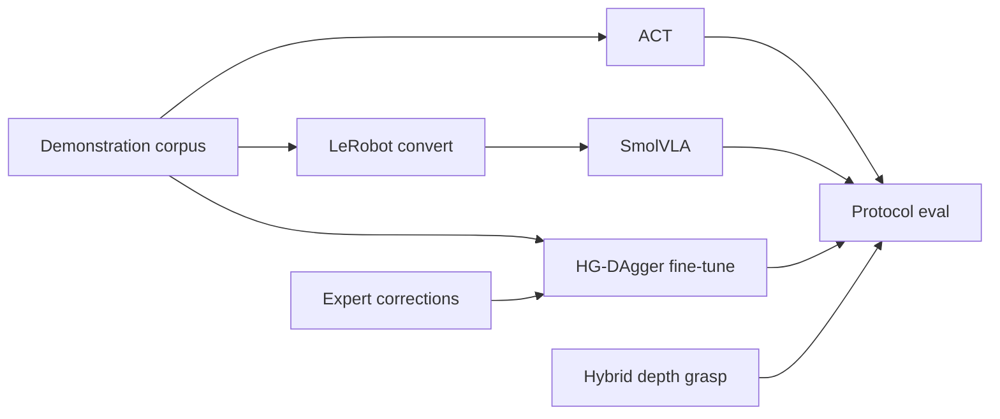

# Visuomotor Policy Learning on Low-Cost Hardware

**Romil Modi** ([romil0001](https://github.com/romil0001))  
Companion software for research on imitation learning, interactive imitation (HG-DAgger), and language-conditioned visuomotor policies for SO-101 manipulation.  
**License:** [MIT](LICENSE)

This repository contains the **offline learning and evaluation software**: dataset schema, Action Chunking Transformer (ACT) training, SmolVLA conversion, human-gated DAgger fine-tuning, hybrid metric-depth grasp control, and protocol-based success metrics. Physical teleoperation, sensing, and closed-loop robot rollouts are maintained separately in [SO101_Visuomotor_Manipulation](https://github.com/romil0001/SO101_Visuomotor_Manipulation).

> **Reporting convention.** Manipulation performance is reported as protocol success rate (`pc_success`) under a fixed scene-condition grid with binary human labels. Offline train loss / validation L1 are diagnostics only.

## Abstract

We study visuomotor manipulation on a low-cost SO-101 dual-arm cell. Human demonstrations are stored in a local multi-view episode format (proprioception, RGB, optional metric wrist depth). Policies are trained offline—ACT with optional depth; SmolVLA via LeRobot export with language task conditioning—and optionally refined with **human-gated DAgger**, which aggregates expert corrections on policy-visited states to mitigate covariate shift. Contact-phase height error is addressed with a hybrid controller that overrides selected joints using wrist depth while leaving approach and place to the learned policy. Evaluation uses a YAML protocol with stratified conditions (object layout) and per-condition success rates. Human-in-the-loop reinforcement learning (e.g. HIL-SERL) is treated as a subsequent stage after a measured imitation / DAgger baseline, and is not implemented in this package.

## Contributions

1. **Self-contained episode dataset** for multi-camera + optional depth demonstrations and DAgger interventions, independent of Hub upload for ACT.
2. **ACT training** with episode-level holdout and checkpoint selection on offline validation L1 (Zhao et al., 2023).
3. **SmolVLA pathway** via deterministic convert to LeRobot format and a thin observation/action wrapper.
4. **Offline HG-DAgger fine-tuning**: merge teleop demos with correction episodes; force interventions into the train split; initialise from a prior ACT checkpoint.
5. **Hybrid depth-assisted grasp**: analytic contact-phase control atop a visuomotor base policy.
6. **Protocol metrics**: `pc_success`, per-condition breakdown, pairwise run comparison, and lab workbook export.

## Empirical baseline (real-robot protocol)

Task: *Place keys into metal cup*. Protocol: `config/pen_to_keys.yaml` (keys left / center / right). Figures below are regenerated from scored trial logs (not synthetic fixtures). Index: [`assets/eval/baseline.json`](assets/eval/baseline.json).

| Method | Trials | Successes | `pc_success` | Notes |
|--------|-------:|----------:|-------------:|-------|
| ACT | 10 | 1 | 10.0% | Partial grid (keys=right not completed in this run) |
| SmolVLA | 15 | 0 | 0.0% | Full 5×3 grid |

| Overall | By condition |
|:---:|:---:|
|  |  |

These rates motivate interactive imitation and contact-phase assistance rather than claiming high asymptotic performance from offline imitation alone.

## Method overview



| Component | Role | Primary references |
|-----------|------|--------------------|
| ACT | Chunked visuomotor imitation | Zhao et al., CoRL 2023 |
| SmolVLA | Language-conditioned VLA fine-tune | LeRobot / SmolVLA |
| HG-DAgger | Interactive imitation; offline merge + fine-tune here | Ross et al., 2011; Kelly et al., ICRA 2019 |
| Hybrid grasp | Metric depth at contact | This work (analytic overlay) |
| Protocol eval | Condition-stratified binary success | Fixed YAML criterion |
| HIL-SERL (planned) | Sample-efficient real-robot RL after IL | Luo et al., 2024 |

Detailed experimental methods: [`docs/methods.md`](docs/methods.md). Package layout: [`docs/architecture.md`](docs/architecture.md).

## Scope and companion repository

| Concern | This repository | Full stack |
|---------|-----------------|------------|
| Dataset I/O, ACT, convert, DAgger fine-tune, metrics | Yes | Uses same schema |
| Leader/follower teleop, ZMQ cameras, live DAgger, robot eval | No | [SO101_Visuomotor_Manipulation](https://github.com/romil0001/SO101_Visuomotor_Manipulation) |

## Installation

```bash
git clone https://github.com/romil0001/so101-visuomotor-ml.git
cd so101-visuomotor-ml
python -m venv .venv && source .venv/bin/activate
pip install -e ".[dev]"
# Optional: pip install -e ".[smolvla]"   # LeRobot for convert / SmolVLA
# Optional: pip install -e ".[jax]"
```

Expect datasets under `data/datasets/<name>/` with the episode layout described in [`docs/methods.md`](docs/methods.md).

## Reproducing offline experiments

```bash
python -m so101_ml inspect --dataset-dir data/datasets/so101_d405_demo
python -m so101_ml train --dataset so101_d405_demo --steps 40000 --val-frac 0.2 --seed 0
python -m so101_ml dagger-finetune --dataset so101_d405_demo --steps 8000
python -m so101_ml convert --dataset so101_d405_demo
python -m so101_ml compare-eval --baseline <run_a>/summary.json --candidate <run_b>/summary.json
python -m so101_ml sheet
```

Runbooks: [`examples/`](examples/).

## Limitations

- Reported baselines use a small number of physical trials; ACT’s published figure is a partial condition grid.
- Live HG-DAgger data collection and closed-loop scoring require the companion hardware repository.
- SmolVLA fine-tuning depends on an external LeRobot environment; depth is not exported into the VLA backbone.
- Human-in-the-loop RL is specified as future work only.

## Citation

If you use this software, please cite:

```bibtex
@software{modi2026so101_visuomotor_ml,
  author = {Modi, Romil},
  title  = {Visuomotor Policy Learning on Low-Cost Hardware},
  year   = {2026},
  url    = {https://github.com/romil0001/so101-visuomotor-ml},
  note   = {Companion hardware stack: https://github.com/romil0001/SO101_Visuomotor_Manipulation}
}
```

See also [`CITATION.cff`](CITATION.cff).

## Acknowledgments

- Zhao et al. for ACT; Ross, Gordon, and Bagnell for DAgger; Kelly et al. for HG-DAgger; Luo et al. for HIL-SERL.
- [Hugging Face LeRobot](https://github.com/huggingface/lerobot) for SO-101 drivers and SmolVLA tooling used in the companion stack.
