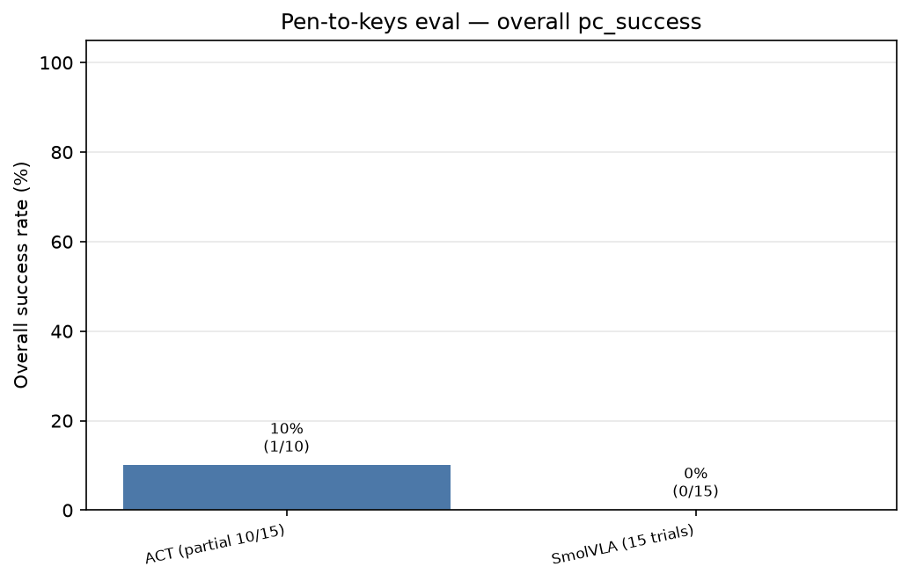
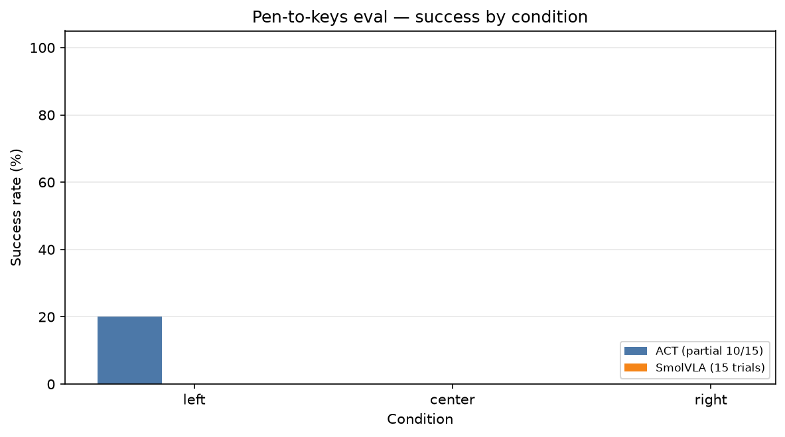
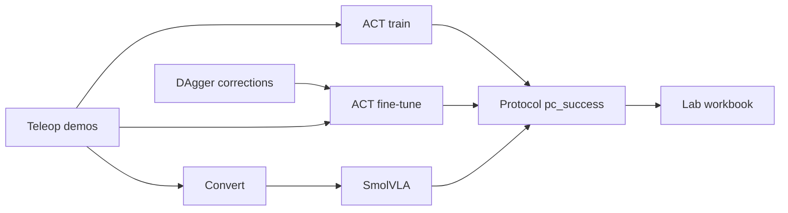

# SO-101 Visuomotor ML

**Author:** [romil0001](https://github.com/romil0001) · **License:** [MIT](LICENSE)

Offline robotics machine learning for low-cost arm manipulation: **ACT**, **SmolVLA**, **human-gated DAgger**, **hybrid depth grasp**, and **protocol-based success rates**.

This repository is a **methods portfolio**. Hardware teleoperation, cameras, and live robot eval live in the full stack:

**→ [SO101_Visuomotor_Manipulation](https://github.com/romil0001/SO101_Visuomotor_Manipulation)**

## Skills demonstrated

| Method | What you will find here |
|--------|-------------------------|
| **ACT** | Action Chunking Transformer training (PyTorch; optional JAX) on a local episode dataset |
| **SmolVLA** | Convert demos → LeRobot format; load a language-conditioned VLA for rollout wrap |
| **HG-DAgger** | Merge human correction episodes + fine-tune ACT (covariate-shift fix). Live pause/takeover is in the full stack |
| **Hybrid grasp** | Metric wrist-depth controller overrides vertical joints near contact |
| **Protocol eval** | `pc_success` and per-condition rates — train loss is not the score |
| **RL (roadmap)** | Human-in-the-loop RL (HIL-SERL-style) after a measured DAgger delta — documented, not shipped in v1 |

## Measured results (real SO-101 trials)

Graphs rebuilt from scored `result.json` logs (not illustrative fixtures):

| Overall | By condition |
|:---:|:---:|
|  |  |

Source index: [`assets/eval/baseline.json`](assets/eval/baseline.json).

## Learning pipeline



## Install

```bash
git clone https://github.com/romil0001/so101-visuomotor-ml.git
cd so101-visuomotor-ml
python -m venv .venv && source .venv/bin/activate
pip install -e ".[dev]"
# optional: pip install -e ".[smolvla]"   # LeRobot for convert / SmolVLA wrap
# optional: pip install -e ".[jax]"
```

## Quick commands

```bash
# Inspect a local dataset folder
python -m so101_ml inspect --dataset-dir /path/to/data/datasets/so101_d405_demo

# Train ACT
python -m so101_ml train --dataset so101_d405_demo --steps 40000

# Offline DAgger fine-tune (corrections already recorded on the robot)
python -m so101_ml dagger-finetune --dataset so101_d405_demo --steps 8000

# Convert for SmolVLA
python -m so101_ml convert --dataset so101_d405_demo

# Compare two protocol summaries
python -m so101_ml compare-eval --baseline a/summary.json --candidate b/summary.json

# Excel / Google Sheets export
python -m so101_ml sheet
```

Place datasets under `data/datasets/<name>/` (same episode schema as the full stack).

## Docs

| Doc | Contents |
|-----|----------|
| [`docs/methods.md`](docs/methods.md) | ACT, SmolVLA, DAgger, hybrid, protocol, RL roadmap |
| [`docs/architecture.md`](docs/architecture.md) | Offline package map |
| [`examples/`](examples/) | Train / DAgger / compare runbooks |

## Citation

```bibtex
@software{so101_visuomotor_ml,
  author = {romil0001},
  title  = {SO-101 Visuomotor ML},
  year   = {2026},
  url    = {https://github.com/romil0001/so101-visuomotor-ml}
}
```
