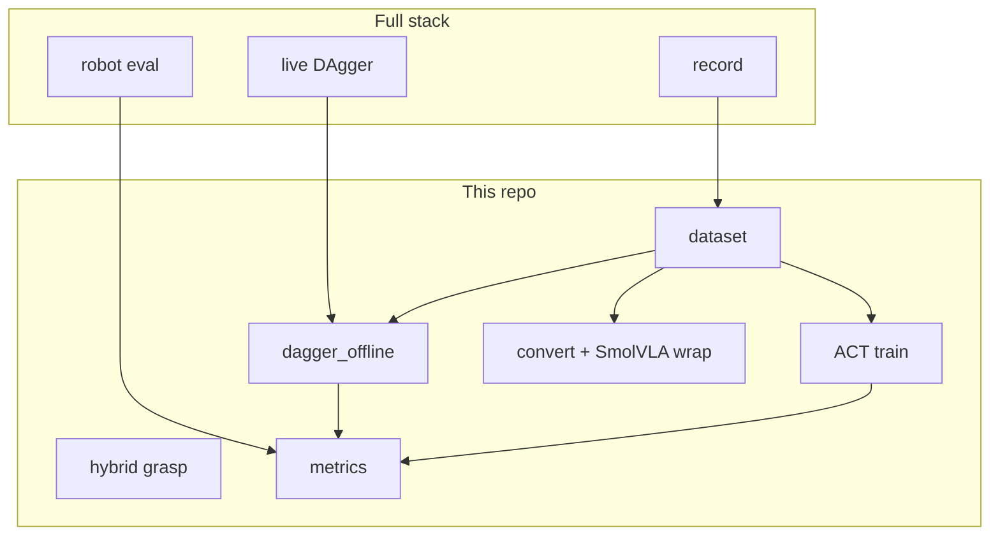

# Architecture (offline ML)

```text
so101_ml/
  dataset/          episode schema, reader/writer, stats, combine
  models/           ACT (torch), optional ACT JAX, SmolVLA wrap
  train.py          ACT training + DAgger fine-tune hooks
  dagger_offline.py combine corrections → fine-tune API
  convert_lerobot.py
  hybrid/           depth grasp + HybridGraspPolicy
  metrics/          protocol schema, compare_eval, lab_sheet, baseline publish
  cli.py            python -m so101_ml …
```

No Feetech, ZMQ, or dashboard imports. Robot record / live DAgger / closed-loop
eval: [SO101_Visuomotor_Manipulation](https://github.com/romil0001/SO101_Visuomotor_Manipulation).


