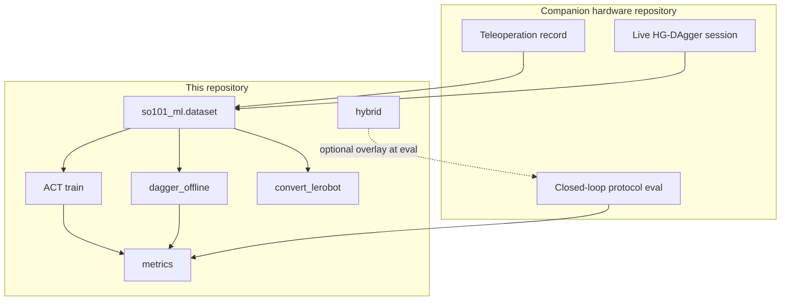

# Software architecture (offline learning)

This package implements the **learning and metrics** half of the SO-101 visuomotor study. It has no dependencies on Feetech buses, ZMQ camera publishers, or operator dashboards. Real-robot acquisition and closed-loop execution remain in [SO101_Visuomotor_Manipulation](https://github.com/romil0001/SO101_Visuomotor_Manipulation).

## Package map

```text
so101_ml/
  dataset/           Episode schema, I/O, statistics, demo∪correction merge
  models/            ACT (PyTorch); optional Flax ACT; SmolVLA observation wrap
  train.py           ACT optimisation, holdout split, DAgger fine-tune hooks
  dagger_offline.py  Public API: combine + fine-tune from disk
  convert_lerobot.py Export to LeRobot for SmolVLA
  hybrid/            Metric-depth grasp controller + HybridGraspPolicy
  metrics/           Protocol schema, summarise, compare, lab workbook
  cli.py             python -m so101_ml …
```

## Data and control flow



## Design choices

| Choice | Rationale |
|--------|-----------|
| Local episode folders | Deterministic, Hub-free ACT; transparent depth and multi-camera layout |
| Episode-level val split | Avoids frame leakage across train/val for the same demonstration |
| Force DAgger episodes into train | Val remains a holdout of original demos; corrections target failure modes |
| Separate checkpoint directories for fine-tunes | Preserve baseline weights for fair protocol comparison |
| Protocol JSON + trial logs | Auditable success labels for papers and lab sheets |

## CLI surface

| Command | Purpose |
|---------|---------|
| `inspect` | Dataset inventory |
| `train` | ACT train / fine-tune with `--corrections` |
| `dagger-finetune` | Explicit combine + fine-tune entry point |
| `convert` | LeRobot export for SmolVLA |
| `compare-eval` | Δ`pc_success` between two `summary.json` files |
| `sheet` | Excel / CSV lab workbook |
